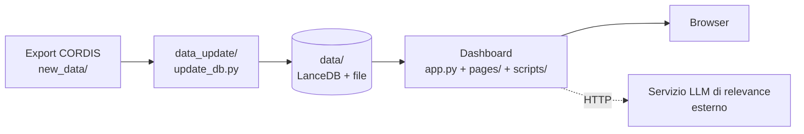

# Architettura

> **Scopo:** spiega com'è organizzato il codice, quali file fanno cosa e come passano i dati dal database allo schermo. Da leggere prima di toccare il codice.

## Due parti separate

La repo contiene due programmi che non si importano a vicenda e comunicano solo tramite la cartella `data/`:

| Parte | Dove | Cosa fa | Quando gira |
|---|---|---|---|
| **Dashboard** | `app.py`, `pages/`, `scripts/`, `utils.py`, `assets/` | Mostra i dati agli utenti (Plotly Dash). Legge `data/`, non scrive mai. | Sempre, come servizio |
| **Pipeline di aggiornamento** | `data_update/` | Importa un nuovo export CORDIS e aggiorna `data/`. | A mano, a ogni nuovo export |

Le due parti condividono lo stesso `requirements.txt` (nella radice) e possono stare nello stesso ambiente Python. Vedi [Avvio della dashboard](../02-dashboard/avvio-dashboard.md) e [Eseguire l'aggiornamento dei dati, sezione P1](../03-aggiornamento-dati/eseguire-update-db.md#p1-preparare-lambiente).

## Mappa dei file

### Dashboard

| File / cartella | Ruolo |
|---|---|
| `app.py` | Crea l'app Dash con `use_pages=True`, la navbar, e alcuni callback clientside. Punto di ingresso: `python app.py`. |
| `utils.py` | Configurazione globale. Legge gli argomenti CLI, carica `.env`, **apre le tabelle LanceDB**, calcola i contatori della homepage e contiene i codici paese. |
| `pages/rag.py` | Pagina `/query`: filtri, tab dei risultati, download CSV. Layout e callback. |
| `pages/overview.py` | Pagina `/concept`: contatori, treemap dei topic, mappa dei progetti. |
| `scripts/_rag.py` | Recupero dei dati: costruzione dei filtri, embedding del testo libero, ricerca vettoriale. |
| `scripts/_rag__projects_list.py` | Costruisce la tab "Lista progetti" (accordion, tabelle di deliverables e pubblicazioni). |
| `scripts/_rag__aggregated_view.py` | Costruisce la tab "Vista aggregata" (KPI e grafici). |
| `scripts/_rag__projects_graph.py` | Costruisce la tab "Grafo dei progetti" leggendo i grafi precalcolati. |
| `scripts/_explainability_api.py` | Chiama il servizio LLM esterno per il pulsante "Why is this relevant?". |
| `scripts/_overview.py` | Contenuto del pannello laterale dei dettagli di un progetto (pagina Concept). |
| `assets/` | File statici serviti da Dash: `style.css`, `navbar.css`, `style.js`, loghi, `treemap.json`, `dmp_for_dash.html`. |

**Convenzione di nome:** una pagina `pages/X.py` ha la logica in `scripts/_X*.py`. Il prefisso `_` e il doppio underscore (`_rag__projects_list.py`) indicano "parte della pagina `rag`, sottosezione `projects_list`". Le pagine contengono layout e callback; gli `scripts/` contengono le funzioni che costruiscono i dati o i componenti.

### Pipeline (`data_update/`)

| File | Ruolo |
|---|---|
| `update_db.py` | Orchestratore: aggiorna progetti, partecipanti, deliverables, publications. |
| `cordis_loader.py` | Legge l'export CORDIS in entrambi i formati (legacy e records). |
| `compute_embeddings.py`, `extract_embedding.py` | Calcolo degli embedding Specter2 e bge-m3. |
| `specter_store.py` | Gestione di `data/specter2.parquet`. |
| `extract_topic.py`, `topic_review.py`, `topic_review_sheet.py` | Assegnazione dei topic, revisione con foglio Excel e spostamento dei progetti già presenti su topic nuovi. |
| `create_projgraph.py` | Precalcola i grafi di collaborazione per topic. |
| `generate_treemap.py` | Rigenera `assets/treemap.json`. |
| `lance_maintenance.py` | Riporta le tabelle LanceDB nello stato atteso dalla dashboard. |
| `format_name.py` | Normalizzazione dei nomi (utility). |
| `settings.config` | Configurazione della pipeline. |
| `test.py` | Suite di test (`pytest test.py -v`, da dentro `data_update/`). |
| `legacy_extract_deliverables.py` | Vecchia estrazione LLM di titoli e autori dai PDF. Tenuto come riferimento. |

I dettagli sull'aggiornamento stanno in [Eseguire l'aggiornamento dei dati](../03-aggiornamento-dati/eseguire-update-db.md); quelli sui dati in [Struttura dei dati](struttura-dati.md).

### Dati (`data/`, non in git)

La cartella `data/` contiene le quattro tabelle LanceDB (`projects_uncase`, `participants`, `deliverables`, `publications`), il modello di embedding `bge-m3-onnx/`, la gerarchia dei topic (`topic2hier.json`), i grafi dei progetti (`project_graphs/`) e i file usati solo dalla pipeline (modello dei topic, `specter2.parquet`, backup). Il ruolo e il formato di ciascun elemento sono in [Struttura dei dati](struttura-dati.md). Per l'elenco dei file necessari all'avvio vedi [Avvio della dashboard](../02-dashboard/avvio-dashboard.md).

## Cosa succede all'avvio

1. `python app.py` importa `utils.py`.
2. `utils.py` **legge gli argomenti da riga di comando** (`--path`, `--port`), carica `.env` e **apre le quattro tabelle LanceDB** in `data/`. Poi legge da `projects_uncase` la lista dei topic e conta progetti, organizzazioni e topic per la homepage.
3. Se `data/` manca o è incompleta, l'app **non parte**.
4. `app.py` crea l'app Dash, registra le pagine in `pages/` e avvia il server su `0.0.0.0` alla porta indicata (default 8050).
5. L'app risponde sotto il percorso base (default `/research_intelligence/`): `/query` e `/concept`.

> Qualunque modulo che importa `utils` eredita la sua riga di comando, perché `argparse` gira al momento dell'import.

## Flusso di una ricerca (pagina `/query`)

1. L'utente imposta filtri e/o testo libero e preme il pulsante di ricerca. Il callback `retrieve_idx` (`pages/rag.py`) chiama `retrieve_results_df` (`scripts/_rag.py`). Se non c'è nessun filtro e nessun testo, non succede nulla.
2. **Filtri.** Diventano una clausola SQL `where` sulla tabella `participants` (programma quadro, paese, tipo e nome di organizzazione, topic, ruolo di coordinatore). Si ottiene l'insieme dei `projectID` che li soddisfano.
3. **Testo libero (opzionale).** Il testo viene trasformato in embedding con bge-m3 (modello ONNX caricato al primo uso, su CPU) e cercato per similarità coseno in `projects_uncase`, limitandosi ai progetti del passo 2. Si tengono al massimo `RETRIEVAL_THRESHOLD` (200) risultati, scartando quelli con distanza coseno oltre 0,45. Se i risultati molto vicini sono pochi (meno di 50), la ricerca si allarga usando il centroide dei migliori. Dettagli e soglie in [Ricerca e filtri](../02-dashboard/pagina-query.md).
4. Il risultato viene salvato in due `dcc.Store` del browser:
   - `retrieved-projects-store`: lista ordinata dei `projectID`;
   - `retrieved-participants-store`: righe di `participants` dei progetti trovati, in JSON.
5. Ogni tab si costruisce a partire da questi due store:
   - **Lista progetti:** legge da `projects_uncase` i dati dei progetti nella pagina corrente. Deliverables e pubblicazioni si caricano da LanceDB solo quando l'utente apre la sezione.
   - **Vista aggregata:** aggrega lo store dei partecipanti.
   - **Grafo dei progetti:** legge i grafi precalcolati in `data/project_graphs/`.
   - **CSV:** esporta lo store dei partecipanti.
6. Il pulsante **"Why is this relevant?"** compare solo se c'è un testo libero. Invia titolo e obiettivo del progetto e il testo dell'utente al servizio LLM esterno e mostra la spiegazione.

## Pagina Concept (`/concept`)

- I tre contatori vengono da `utils.py`.
- La treemap viene da `assets/treemap.json`, generato dalla pipeline (`generate_treemap.py`).
- La mappa dei progetti è un file HTML statico, `assets/dmp_for_dash.html`, mostrato in un iframe. Un clic su un punto manda un messaggio alla pagina (`postMessage`), che apre il pannello laterale con i dettagli del progetto letti da `projects_uncase`.

## Servizi esterni

| Servizio | Usato da | Configurazione |
|---|---|---|
| Servizio LLM di relevance (`http://research-llm-api-matita:8060/v1/project/relevance`) | `scripts/_explainability_api.py` | URL **scritto nel codice**. Non è in questa repo. |
| CORDIS (`cordis.europa.eu/project/id/<id>`) | Link "View on CORDIS" | Solo link, nessuna chiamata. |

## Cose da sapere

- **Callback verso componenti di altre pagine.** Alcuni callback clientside in `app.py` puntano a componenti definiti nei layout delle pagine (`taxonomy-section`, `dummy`, `project-graph`, `project-graph-view-store`). Funziona solo perché l'app usa `suppress_callback_exceptions=True`.

- `.env` definisce `EXPLAINABILITY_BASE_URL` e `EXPLAINABILITY_API_KEY`, letti da `utils.py`. Oggi `_explainability_api.py` importa quei valori ma **non li usa**: l'URL è fisso e l'intestazione con la chiave è commentata. Se il servizio cambia server, va modificato il codice.

## Pagine collegate

- [Struttura dei dati](struttura-dati.md)
- [Avvio della dashboard](../02-dashboard/avvio-dashboard.md)
- [Pagina Query, sezione "Come modificare la pagina"](../02-dashboard/pagina-query.md#11-come-modificare-la-pagina)
